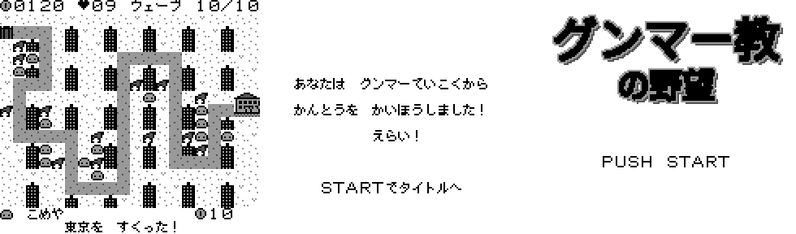

# グンマー教の野望（ゲームボーイ）

> これはフリーで配布されたゲームです。製品版はありません。もし買われた方がいたらそれは詐欺です。警察に相談してください。
> GrokBOTでチームを組んで作成しました。

## ダウンロード
- [gunma.gb](gunma.gb)：mGBAなどのエミュレータで遊べます。

## 遊び方
グンマー帝国から一都5県（栃木・茨城・埼玉・千葉・神奈川・東京）を救うタワーディフェンスです。各面10ウェーブで、道に沿って攻めてくる敵をユニットを置いて食い止めます。東京を救うとエンディングです。

## 担当ごとの成果物
1. [企画：仕様書](docs/SPEC.md) と [制作の流れ](docs/PLANNING.md)
2. [仕様・環境構築：開発環境とデバッグ](docs/ENVIRONMENT.md)
3. [グラフィック](docs/GRAPHICS.md)
4. [プログラム構成とテスト](docs/PROGRAMMING.md)
5. [音楽](docs/SOUND.md)

ソースコードは公開していません。
