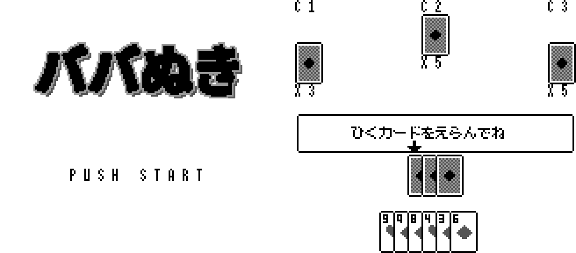

# ババ抜き（ゲームボーイ）

> これはフリーで配布されたゲームです。製品版はありません。もし買われた方がいたらそれは詐欺です。警察に相談してください。
> GrokBOTでチームを組んで作成しました。

## ダウンロード
- [babanuki.gb](babanuki.gb)：mGBAなどのエミュレータで遊べます。

## 遊び方
プレイヤー1人とCPU3人で遊びます。十字キーの左右でカードを選び、Aで引きます。STARTはゲームの開始とタイトルに戻る時に使います。

## 担当ごとの成果物
1. [企画：仕様書](docs/SPEC.md) と [制作の流れ](docs/PLANNING.md)
2. [仕様・環境構築：開発環境とデバッグ](docs/ENVIRONMENT.md)
3. [グラフィック](docs/GRAPHICS.md)
4. [プログラム構成とテスト](docs/PROGRAMMING.md)
5. [音楽](docs/SOUND.md)

ソースコードは公開していません。
