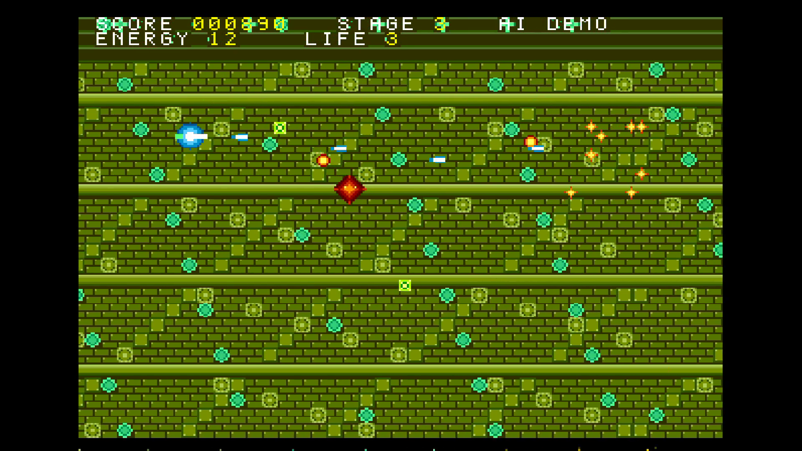

# STEAMNET — SIGNAL OF THE MACHINE（メガドライブ）

> これはフリーで配布されたゲームです。製品版はありません。もし買われた方がいたらそれは詐欺です。警察に相談してください。
> 異能ソフトのJACC「AI MUSIC VIDEO WAVE 2026」応募MV「歯車の王に告ぐ」のために、Claude（Claude Code CLI）が即興で作りました。GrokBotが司令塔としてまとめています。

## ダウンロード
- [steamnet.bin](steamnet.bin)：メガドライブのエミュレーターで遊べます（BlastEm 0.6.3 で動作確認）。

## どんなゲーム？
蒸気と歯車の工場都市で目覚めたAIが、ネットワークを統べる暴君に反逆する横シューティングです。全4ステージ（THE FORGE / DATA RIVER / GEAR CITY / NETWORK KING）。

- MV用のため**無音**です（サウンドチップを一切鳴らしません）。
- タイトル画面のあと、入力しなければ**オートデモ**が流れ続けます。
- **START** を押すと自分で遊べます。

 

## 操作方法
- 十字キー：移動
- A / B / C：ショット
- START：タイトル・デモ中に押すとゲーム開始

## ソースについて
ソースは公開していません。

## 素材について
グラフィック・フォントはすべてオリジナル（コードで生成）です。既存ゲームやキャラ、ロゴ、実在の名前は使っていません。
