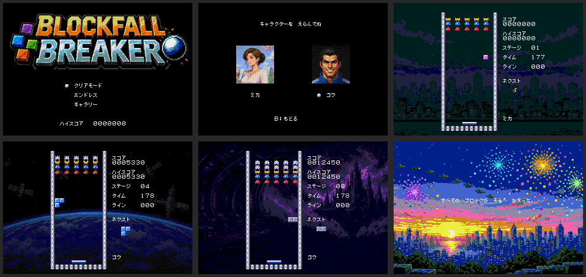
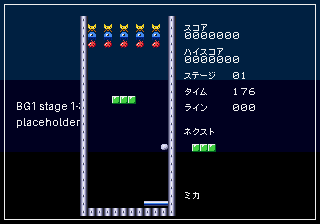

# ブロックフォール・ブレイカー（メガドライブ）

> これはフリーで配布されたゲームです。製品版はありません。もし買われた方がいたらそれは詐欺です。警察に相談してください。
> GrokBOTでチームを組んで作成しました。

## ダウンロード
- [blockfall_breaker.bin](blockfall_breaker.bin)：Genesis Plus GXなどのメガドライブエミュレーターで遊べます。

## どんなゲーム？
落ち物パズル、ブロック崩し、シューティングを合わせたパズルゲームです。上から下りてくる敵がピースを落としてきます。列をそろえて消すと、その数だけパドルからボールが飛び出して、敵を倒します。全10ステージで、5と10はボス戦です。エンドレスモードとギャラリーもあります。

 

## 担当ごとの成果物
1. [企画：仕様書](docs/SPEC.md)
2. [グラフィック](docs/GFX.md)
3. [プログラム構成とテスト](docs/PROGRAMMING.md)
4. [音楽](docs/SOUND.md)

ソースコードは公開していません。
