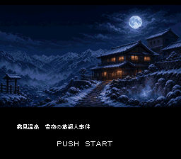
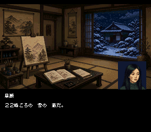
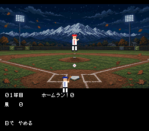
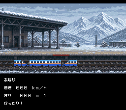

# 霧見温泉 雪夜の蔵殺人事件（スーパーファミコン）

> これはフリーで配布されたゲームです。製品版はありません。もし買われた方がいたらそれは詐欺です。警察に相談してください。
> GrokBOTでチームを組んで作成しました。

## ダウンロード
- [kirimi.sfc](kirimi.sfc)：snes9xなどのスーパーファミコンエミュレーターで遊べます。

## どんなゲーム？
群馬県・吾妻地方の架空の温泉町「霧見」が舞台の推理アドベンチャーです。大雪の翌朝、温泉旅館の主人が裏の蔵で死んでいるのが見つかります。群馬県警の刑事になって、相棒の新人刑事・野々宮ハルと一緒に、「きく」「しらべる」「みせる」などのコマンドを選んで捜査します。全5章です。

おまけのミニゲームが2つあります。
- **からっ風ホームラン**：10球のうち3本ホームランを打てば成功です。
- **上越新幹線 ぴたっと停車**：高崎、上毛高原、越後湯沢の3駅で、停止線ぴったりに止めます。

 
 

## 担当ごとの成果物
※ 仕様書には犯人とトリックが書いてあります。遊ぶ前に読むとネタバレになります。
1. [企画：仕様書](docs/SPEC.md) と [台本の書き方](docs/SCRIPT_FORMAT.md)
2. [仕様・環境構築：開発環境とテスト](docs/ENVIRONMENT.md)
3. [グラフィック](docs/GFX.md)
4. [プログラム構成とテスト](docs/PROGRAMMING.md)
5. [音楽](docs/SOUND.md)

## 大変だったところ（担当ごとのふりかえり）
- [企画](docs/HARD_PLANNING.md)
- [仕様・環境構築](docs/HARD_ENVIRONMENT.md)
- [グラフィック](docs/HARD_GRAPHICS.md)
- [プログラム](docs/HARD_PROGRAMMING.md)
- [音楽](docs/HARD_SOUND.md)

ソースコードは公開していません。
