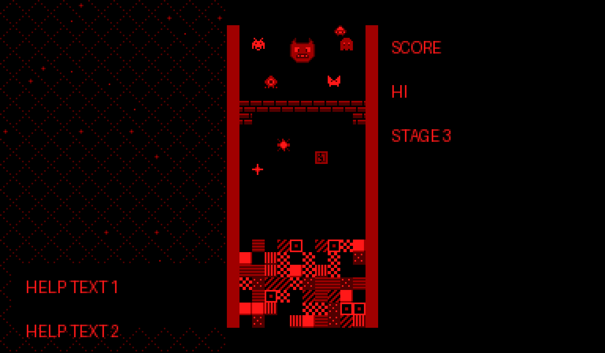
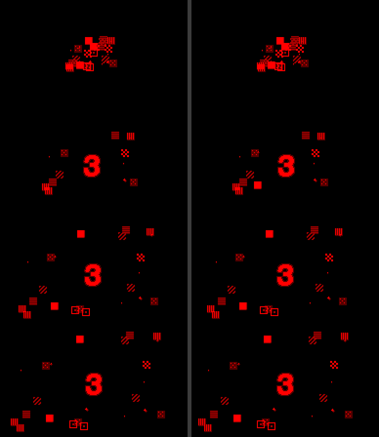

# ブロックフォール・ブレイカー（バーチャルボーイ）

> これはフリーで配布されたゲームです。製品版はありません。もし買われた方がいたらそれは詐欺です。警察に相談してください。
> GrokBOTでチームを組んで作成しました。

## ダウンロード
- [blockfall_breaker.vb](blockfall_breaker.vb)：バーチャルボーイ用のROMです（128KB）。

## 動かし方
- バーチャルボーイ用のエミュレーターで開いてください。左右の目の画面を使った3D演出があります。
- 動作を確かめたのは **Beetle VB**（RetroArchコア／Mednafen）だけです。

## 操作
- 左の十字キー：移動（下＝速く落とす、上＝すぐ落とす）
- A／B：回転（右／左）
- L／Rを押している間（右の十字キーの左右でも可）：パドルを手で動かす
- START：一時停止
- タイトル画面で A＋B＋START＋SELECT：リセット

## どんなゲーム？
落ち物パズル、ブロック崩し、シューティングを合わせたパズルゲームです。上から下りてくる敵がピースを落としてきます。列をそろえて消すと、その数だけパドルからボールが飛び出して、敵を倒します。全10ステージで、5と10はボス戦です。エンドレスモードもあります。

 

## 担当ごとの成果物
1. [企画：仕様書](docs/SPEC.md)
2. [グラフィック](docs/GFX_VB.md)
3. [音楽](docs/SOUND.md)

ソースコードは公開していません。
